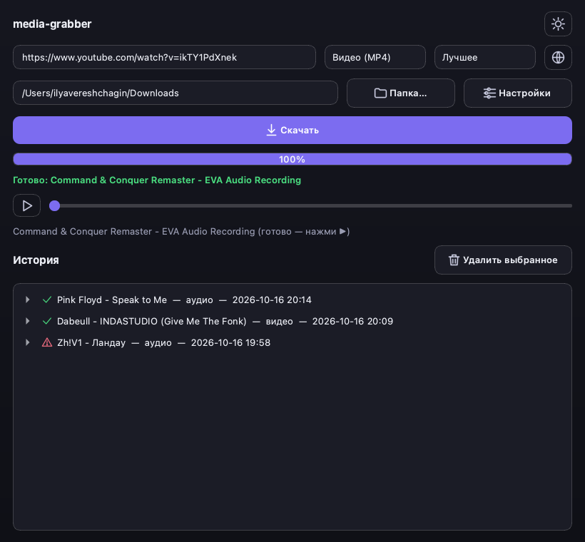
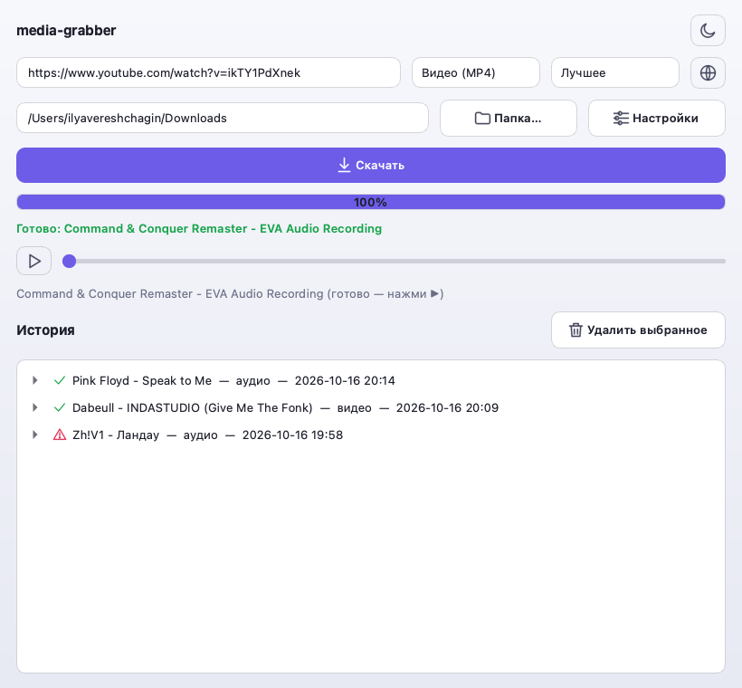

# media-grabber

[](https://github.com/wwakabobik/media-grabber/actions/workflows/lint.yml)
[](https://github.com/wwakabobik/media-grabber/releases)
[](LICENSE)


[-41cd52)](https://doc.qt.io/qtforpython/)

A small desktop app: paste a YouTube / Vimeo / SoundCloud / VK / Spotify / Yandex Music link
(including a playlist or album), pick a format and quality, hit download, and watch or listen
right in the window — no browser, no external player.


<p align="center">
  
  
</p>

## Design

A minimalist glass look (translucent cards, soft gradients, rounded corners, one consistent
button style) with a Light / Dark / System theme picker in the header next to Settings,
persisted between runs; System follows the OS's own appearance live, including a change made
while the app is open. Icons are small hand-drawn lucide-style SVGs tinted per theme at render
time — no icon font, no asset files. QSS can't do the OS's real frosted-glass blur (that needs
native `NSVisualEffectView`, out of scope for a Qt app — see Known limitations), so this fakes
the vibe with translucency and soft borders instead.

## How it gets the media

- **YouTube / Vimeo / SoundCloud / VK** (and anything [yt-dlp](https://github.com/yt-dlp/yt-dlp)
  supports) are downloaded directly.
- **Spotify** streams are DRM-protected and can't be ripped from Spotify itself.
  [spotdl](https://github.com/spotDL/spotify-downloader) reads the track's metadata from Spotify
  and pulls the matching audio from YouTube instead — Spotify is only ever used for the lookup.
- **Yandex Music** tracks download for real (no YouTube-matching detour), but Yandex's API has no
  anonymous access like Spotify's — you need your own account's OAuth token, set once in
  **Settings**.
- **Playlists / albums / multi-track links** (YouTube playlists, SoundCloud sets, Spotify
  albums/playlists, Yandex Music albums/playlists) are detected before downloading: a picker
  dialog lists every track/video with a checkbox so you choose what actually gets downloaded,
  then they're fetched one by one with per-item progress into a subfolder named after the
  playlist/album (so they land together, not scattered loose in the destination folder).
- **Metadata**: cover art, title/uploader/description get embedded automatically (YouTube/Vimeo/
  SoundCloud/VK via yt-dlp's thumbnail+metadata postprocessors; Spotify via spotdl, which already
  embeds full ID3 tags + cover art; Yandex Music tagged by hand with `mutagen`, since the library
  only saves raw audio). Video downloads also get `.ru`/`.en` `.vtt` subtitle files alongside,
  fetched one language at a time as a separate best-effort pass (so a rate limit on one language,
  or no captions at all, never breaks the actual video download or costs you the other language).
  Spotify lyrics (via spotdl's own lyrics providers) and Yandex Music lyrics (via its own lyrics
  API) are picked up when available and viewable/exportable right from the app — see Features.

Realistic *download* format choices: **MP4 / WebM** video, **MP3** audio — none of these sites
serve anything else, so there'd be nothing to download into another container. Spotify and
Yandex Music are audio-only — picking one of those links greys out the video option instead of
letting you hit an error. Once a file is on disk, **Convert** (see Features) offers a much wider
set of formats, since that's a local `ffmpeg` transcode, not a download.

## Features

- URL + format dropdown (video/audio) + quality picker (Best / 1080p / 720p / 480p / 360p).
  Destination folder, Yandex Music token and the UI language live in Settings, remembered
  between runs.
- **English and Russian UI**, switchable from Settings — no restart needed.
- Search box *and* filter dropdowns (source / format / folder / type / status) above the history
  list, combined with AND semantics — "status" is on disk / missing / error, "type" is audio/video.
- **Convert**: turn any downloaded file into another format from its history entry — video to
  MP4/WebM/MKV/MOV/AVI, or pull just the audio out as MP3/WAV/M4A/FLAC/OGG/AAC/Opus (never the
  other way around) — via `ffmpeg`, saved as a separate file alongside the original, with an
  animated progress pulse (ffmpeg doesn't report a percentage the way a download does).
- Progress bar fed by yt-dlp's real download progress, with an overlay that blocks the controls
  while a download is in flight — hidden the rest of the time, not stuck at a stale 0%/100%.
- Built-in preview player ([Qt Multimedia](https://doc.qt.io/qt-6/qtmultimedia-index.html)) for
  both video and audio — play/pause, seek — so nothing needs to be opened in another app. Stays
  out of the way (hidden) until something is actually loaded into it.
- History with multi-select: every attempt (success or failure) is kept, with the error message
  for failed ones. Delete selected entries from the list only, or from disk as well. An entry
  whose file was removed outside the app is shown greyed out instead of crashing or lying about
  its status. A repeat download of the same title never overwrites the previous file — it gets
  a `(1)`, `(2)`, ... suffix, like a browser's download manager.
- **🌐 Open in browser**: open the pasted link, or any history entry's original link, in your
  default browser without leaving the app.
- Playlist/album links open a checkbox picker instead of downloading blind; picked items queue
  up and download one at a time, each landing in the history individually, into a subfolder
  named after the playlist/album.
- **Live preview**: ~700ms after a URL settles, a background fetch shows its title, duration and
  cover art above the Download button — so you see what you're about to grab before committing,
  not just after.
- Each history entry shows cover art, duration and the download timestamp, and expands (click
  the chevron or anywhere on the row) into Play / Show in Finder / Convert / Open link actions.
- Description (YouTube/Vimeo/SoundCloud/VK), lyrics (Spotify/Yandex Music) or YouTube's chapters,
  when available, show in the history entry and next to the in-app player, with a "Save as…"
  button to export to a `.txt` file wherever you like.
- The video player can be collapsed back to just its controls without stopping playback, and the
  whole window scrolls if its content doesn't fit — nothing is ever stuck unreachable.
- Persisted to `~/.config/media-grabber/state.json`.
- Structured logging ([structlog](https://www.structlog.org/)): human-readable in the console,
  JSON with keyword context (url, kind, path, errors...) in a rotating file at
  `~/.config/media-grabber/logs/media-grabber.log` (5 MB x 5 backups).

## Known limitations

- YouTube's highest-quality streams are often encoded in **AV1**, which `QtMultimedia`'s bundled
  ffmpeg backend can't hardware-decode on most machines (plays audio with no picture). The app
  explicitly prefers H.264 (`avc1`) for video downloads to avoid this.
- Spotify downloads are a metadata-driven YouTube search (via spotdl), not an actual rip of
  Spotify's own audio stream — quality and match accuracy depend on what's available on YouTube.
- Yandex Music needs your personal account's OAuth token (there's no public client-credentials
  flow like Spotify's) — without one, Yandex links fail with a clear "add a token" error.
- SoundCloud's *original* (highest-quality) format needs login too; without it yt-dlp falls back
  to the standard transcoded stream, which works fine but isn't the uploader's original file.
- **Vimeo currently fails for most videos** with `"The web client only works when logged-in"` —
  an upstream restriction Vimeo added that yt-dlp's cookie-less extraction can't work around.
  YouTube/SoundCloud/VK were all verified with real end-to-end downloads; Vimeo needs a logged-in
  session (cookies) to fix, which this app doesn't support and isn't planned to.
- The "glass" look is QSS translucency + soft borders, not real compositor blur — Qt widgets
  can't get native macOS vibrancy without a lot more platform-specific plumbing.

## Quickstart

```bash
uv sync
uv run python main.py
```

Requires `ffmpeg` on `PATH` (used for audio extraction and video muxing).

### Building a standalone `.app` (macOS)

```bash
uv run pyinstaller --windowed --name "MediaGrabber" --icon=icon/AppIcon.icns \
  --collect-data pykakasi --collect-data ytmusicapi --noconfirm main.py
```

The `--collect-data` flags are required: spotdl's dependency chain (`pykakasi`, `ytmusicapi`)
ships data files (dictionaries, locale `.mo` files) that PyInstaller doesn't pick up on its own —
without them Spotify downloads fail inside the bundled `.app` with a missing-file error, even
though `uv run python main.py` works fine (it reads straight from the dev venv's site-packages).

The result is in `dist/MediaGrabber.app` — copy it to `/Applications` to install.

## Tech stack

- **UI**: [PySide6](https://doc.qt.io/qtforpython/) (Qt for Python), incl. Qt Multimedia for the
  in-app player and Qt SVG for the icon set (`theme.py` — color tokens, QSS, icon rendering)
- **Download backends**: [yt-dlp](https://github.com/yt-dlp/yt-dlp),
  [spotdl](https://github.com/spotDL/spotify-downloader),
  [yandex-music](https://github.com/MarshalX/yandex-music-api)
- **Logging**: [structlog](https://www.structlog.org/) (`logger.py`)
- **Packaging**: [uv](https://docs.astral.sh/uv/) for dependency management,
  [PyInstaller](https://pyinstaller.org/) for the `.app` bundle
- **Python**: 3.12+

## Contributing

See [CONTRIBUTING.md](CONTRIBUTING.md). Short version: `master` is protected — every change
lands via pull request and must pass CI (`ruff` + `pytest`, all green) before it can be merged,
including for the repo owner. Every merge gets a semver tag + GitHub Release (see
[CHANGELOG.md](CHANGELOG.md)) — bump `pyproject.toml`'s version yourself for a real
feature/breaking change, otherwise it gets an automatic patch bump on merge.

```bash
uv sync --all-groups
uv run ruff check .
uv run pytest -q
```

Found a security issue? See [SECURITY.md](SECURITY.md) — please don't open a public issue for
it.

## Donations

If you like this project, you can support it by donating via
[DonationAlerts](https://www.donationalerts.com/r/rocketsciencegeek),
[Buy me a coffee](https://www.buymeacoffee.com/wwakabobik) or
[Thanks Dev](https://thanksdev.com/wwakabobik).

## License

[MIT](LICENSE)
